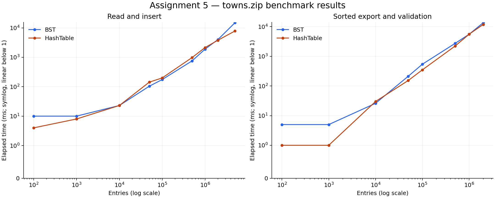

# Assignment 5 verification

Verified on 18 November 2026 using Oracle JDK 24.0.1 and Maven 3.9.9,
compiling for Java 18 as configured by the unchanged pom.xml.

## Implementation

- Algorithms.java reuses the completed Assignment 4 quicksort and its helpers
  from codax21272/DSA-04-binarysearch. The supplied partitionByRule method and
  a swap helper were added, plus comparator insertion sort for ComparatorTester.
- Person hashes the full name using the DJB2 XOR recurrence (seed 5381,
  multiply by 33 then XOR each UTF-16 character). Using exactly the full name
  preserves the existing equals/compareTo contract, including spaces inside names.
- The hash table uses plain arrays, linear probing, a 0.65 maximum load, and
  doubling growth. floorMod handles all signed hashes, including MIN_VALUE.
  Rehashing finishes before replacement storage is published. Impossible capacity
  requests fail before changing contents. Successful ensureCapacity resets the
  dictionary as explicitly specified in Dictionary.java.
- The BST reuses the supplied hash-ordered TreeNode and linked collision chains.
  Duplicate updates in collision chains no longer inflate the count. Export uses
  the supplied visitor and quicksort; empty export and status are safe. Depth is
  measured in edges; collision-chain status is specific to each tree.

No Collection/Map containers or library sorting algorithms were introduced.
The existing comparator demo uses Arrays.toString only for display.
The instructor's test sources and PhoneBook.txt are unchanged.

## Correctness

The required classes were first run separately in the requested order using
`mvn -B -Dtest=CLASS test`. PhoneBookTests ran as a complete class with
`'-Dsurefire.timeout=120' '-Dsurefire.exitTimeout=10'` to bound a possible hang.

The final combined verification command was:

```powershell
mvn -B '-Dtest=GenericTests,ContentsTests,HashFuncTests,PhoneBookTests' '-Dsurefire.timeout=120' test
```

| Class | Executed | Failures | Errors | Skipped |
|---|---:|---:|---:|---:|
| GenericTests | 4 | 0 | 0 | 0 |
| ContentsTests | 4 | 0 | 0 | 0 |
| HashFuncTests | 2 | 0 | 0 | 0 |
| PhoneBookTests | 3 | 0 | 0 | 0 |
| Total | 13 | 0 | 0 | 0 |

Surefire XML reports were inspected. Both HASHTABLE and BST executed; their
getType methods return their implemented types. JaCoCo reports no execution data
under the supplied configuration; no coverage claim is made.

Additional verification, without changing instructor tests:

```powershell
javac -encoding UTF-8 -cp target/classes -d target/verification verification/DictionaryChecks.java
java -cp 'target/classes;target/verification' DictionaryChecks
```

Passed for both implementations: empty dictionaries, 400 heavily colliding keys,
MIN_VALUE/negative/MAX_VALUE hashes, duplicate collision-chain replacement,
compression, sorted exports, export independence, absent keys, null arguments,
Person identity boundaries, and hash table allocation-failure preservation.

## Observed performance

Final combined correctness run, using the original 12,345-entry PhoneBook.txt:

| Operation | Linear array | Hash table | BST |
|---|---:|---:|---:|
| Read and insert (ms) | 3148.0144 | 13.6949 | 17.1079 |
| Six successful lookups total (ms) | 6.4896 | 0.0218 | 0.0428 |
| Lookup speed relative to linear | 1 | 297.69 | 151.63 |

The separate PhoneBookTests run also passed: lookup totals were 54.9505 ms,
0.0462 ms and 0.0507 ms respectively. These small, cold measurements vary with
JIT compilation and scheduling; they demonstrate passing the supplied threshold,
not a statistically controlled benchmark. Insertion includes file parsing.

The hash table had capacity 19,968, fill 61.82%, 22,898 cumulative probe
collisions including rehashing, worst probe distance 50, and 9 reallocations.
The BST's longest root-to-leaf path was 33 edges (balanced ideal 13), shortest
leaf path 5, and no extra collision-chain entries for this input.

Expected hash-table insertion/lookup is amortized O(1) with a good hash, with
O(n) worst-case probing and O(n) storage. Growth rehashes entries; compression
reduces unused slots while respecting the load threshold. A hash collision here
means an occupied probe slot, which does not necessarily mean equal hash codes.
The BST is unbalanced: expected O(log n) operations for well-distributed hashes,
O(n) worst case, with linear scans for equal-hash chains. The supplied recursive
tree helpers can exhaust the stack for pathological tree depths. Export is
O(n) copying plus average O(n log n) quicksort (worst O(n squared)); quicksort
recurses only into the smaller partition to bound sorting stack use to O(log n).

One hash function and one load threshold were tested; no comparative tuning or
quicksort-versus-heapsort measurement is claimed. No heap/stack overrides were
needed for the available correctness data.

## Full towns dataset verification — 21 November 2026

The supplied towns.zip was extracted selectively. Its PhoneBook.txt was excluded
so the original fixture remains unchanged. All nine external datasets and the
archive remain ignored by Git. Production sources and instructor tests required
no changes for these checks.

The machine now defaults to JDK 17, which cannot run the project's Java 18
bytecode. The first performance invocation therefore failed before executing any
tests. Selecting the installed JDK 24 resolved that environment mismatch without
changing pom.xml or lowering the project's Java target.

```powershell
$env:JAVA_HOME = 'C:/Program Files/Java/jdk-24'
mvn -B '-Dtest=PerformanceTestsAdd,PerformanceTestsToArray' '-DargLine=-Xmx4g' '-Dsurefire.timeout=1800' test
mvn -B '-Dtest=GenericTests,ContentsTests,HashFuncTests,PhoneBookTests' '-Dsurefire.timeout=120' test
python verification/plot_performance.py
```

The performance run completed in 1 minute 37 seconds with 4 test methods, zero
failures, zero errors, and zero skips. Both structures were exercised across all
datasets specified by each class. Insertion asserts exact population counts;
sorted export checks both counts and ascending order. The correctness rerun
passed all 13 methods with zero failures, errors, or skips. The six Surefire XML
reports therefore show 17 passing methods in total. This was two Maven runs,
not one combined run. JaCoCo still reports no execution data.

### Measurements

All times below are the actual integer milliseconds emitted by the unmodified
tests. Insertion includes reading and parsing the file. Sorted export includes
the test's order-validation loop. Each measurement is a single run; JIT, garbage
collection, and I/O affect comparisons, especially for small inputs. The tests
do not attempt a five-million-entry sorted export.

| Entries | BST read/insert (ms) | HashTable read/insert (ms) | BST export (ms) | HashTable export (ms) |
|---:|---:|---:|---:|---:|
| 100 | 10 | 4 | 5 | 1 |
| 1,000 | 10 | 8 | 5 | 1 |
| 10,000 | 23 | 23 | 26 | 30 |
| 50,000 | 104 | 143 | 213 | 153 |
| 100,000 | 175 | 199 | 540 | 349 |
| 500,000 | 757 | 983 | 2,723 | 2,212 |
| 1,000,000 | 1,886 | 2,139 | 5,543 | 5,558 |
| 2,000,000 | 4,001 | 3,801 | 13,544 | 11,841 |
| 5,000,000 | 14,941 | 7,834 | Not tested | Not tested |



The graph uses logarithmic population and symmetric-log elapsed-time axes, with
a linear region below 1 ms. The plot script preserves any zero-ms measurements.
All 34 measurements, the input archive SHA-256, and the performance tests'
status output are saved in [performance/measurements.json](performance/measurements.json).
The graph can be regenerated from the ignored compare-add.csv and
compare-toarray.csv outputs plus the local Surefire reports using the script
above (Python with Matplotlib is required).

The final correctness run's six lookups took 9.7393 ms for the linear array,
0.0511 ms for HashTable, and 0.0678 ms for BST: about 190.59x and 143.65x faster
than linear respectively. Both passed the supplied 100x assertion. These lookup
measurements use the original 12,345-entry phonebook, not the large towns files;
the supplied performance classes do not benchmark lookup.

### Interpretation

At five million entries, HashTable had 8,126,464 slots (61.53% occupied),
8,912,241 cumulative occupied-slot collisions including rehashing, a worst probe
distance of 97, and 18 reallocations. Its 0.65 load limit leaves room for probing;
doubling growth explains why the final fill varies with population. Across the
nine files, the worst reported probe distance was 104 at one million entries.
These counters show successful collision resolution and growth, not a count of
distinct equal-hash pairs. Roughly 38.47% of the five-million-entry array slots
were unused; no alternative load-factor benchmark was performed.

BST depth grew from 12 edges at 100 entries to 57 at five million, compared with
an ideal balanced depth of 22 at five million. Its longest extra collision chain
was 2 at five million, so that node held its main pair plus two list entries.
This hash distribution avoided extreme tree depth on these datasets, but the
tree remains unbalanced and offers no worst-case logarithmic guarantee.

From one to five million entries, insertion time rose from 1,886 to 14,941 ms
for BST and from 2,139 to 7,834 ms for HashTable. HashTable was about 1.91x faster
at the largest input. The timings are compatible with efficient hash insertion
and additional tree traversal cost, but cannot establish complexity empirically
from one run. File parsing and garbage collection are included. From one to two
million entries, sorted-export time rose by about 2.44x for BST and 2.13x for
HashTable, consistent with the extra work of O(n log n) sorting. Both structures
still use the same reused quicksort; no heapsort comparison was performed.

The large benchmarks were run with a 4 GB heap cap; no stack-size override was
needed. All requested datasets, performance classes, report, and graph are now
covered. The archive and external text datasets must remain outside the commit.
